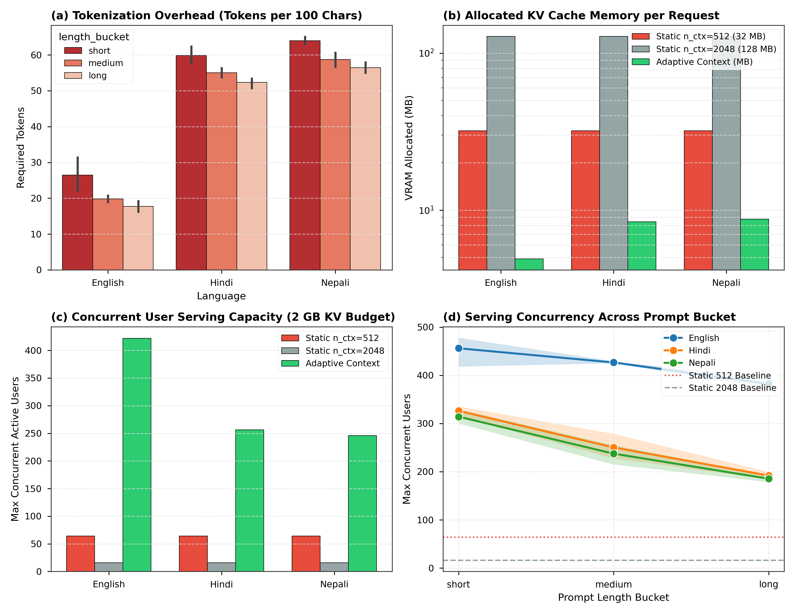
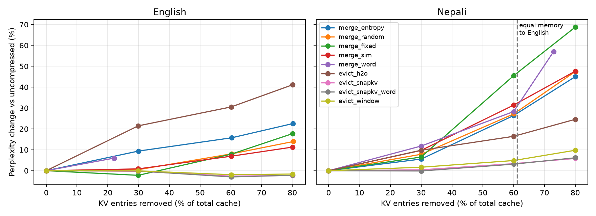

# Language-Fair LLM Serving: The Systems Cost of Tokenizer Fertility and KV-Cache Compression for Devanagari

[](https://www.python.org/downloads/)
[]()
[]()

**Ashutosh Bhattarai** · Pulchowk Campus, Institute of Engineering, Tribhuvan University, Nepal · `bhattaraiaasu1@gmail.com`

> **Experimental Scope & Epistemic Status.** This repository documents an ongoing empirical investigation into language-dependent LLM serving overheads. Current measurements are restricted to Llama 3.2 1B Instruct (FP32), paired English–Nepali evaluation sets ($n = 8$ to $30$ documents), and CPU / Apple Silicon execution. All findings are strictly bounded by sample size and hardware tier in the [Claims & Evidence Ledger](#5-claims--evidence-ledger).

---

## Executive Summary

| Dimension | Empirical Observation |
| :--- | :--- |
| **Systems Bottleneck** | High tokenizer fertility forces Devanagari (Nepali) to consume $\approx 2.5\times\text{--}2.6\times$ the tokens of English for equivalent semantic content, scaling per-request KV-cache memory and prefill FLOPs linearly. |
| **Core Question** | Can post-prefill KV-cache compression equalize memory footprints across languages without degrading downstream generation or retrieval fidelity? |
| **Primary Result 1 (Perplexity)** | At an equal-memory budget ($61\%$ Nepali KV-entry removal), query-aware eviction (`evict_snapkv`) incurs $+3.5\%$ perplexity ($0.84$ top-1 agreement), whereas all tested vector-merging baselines degrade perplexity by $27.5\%\text{--}46.8\%$. |
| **Primary Result 2 (Retrieval)** | Query-aware eviction preserves planted long-range facts through $60\%$ compression ($8/8$ in both languages). Word-aligned eviction (`evict_snapkv_word`) achieves $8/8$ recall at $80\%$ compression in Nepali vs. $6/8$ for token-level eviction (suggestive; sign-test $p = 0.50$). |
| **Unverified Hypotheses** | Causal attribution of merging failure to post-RoPE rotational phase interference; physical GPU VRAM/latency savings under continuous batching (`vLLM` / PagedAttention). |
| **Parity Verification** | `python kv_compress.py --selftest` (validates custom forward pass against Hugging Face reference within $\approx 2 \times 10^{-7}$ max logit delta). |

**Contents:** [Abstract](#abstract) · [1. Systems Motivation](#1-systems-motivation--research-questions) · [2. Methodology](#2-experimental-methodology--baselines) · [3. Results](#3-empirical-results) · [4. Discussion](#4-mechanistic-discussion) · [5. Claims Ledger](#5-claims--evidence-ledger) · [6. Threats to Validity](#6-threats-to-validity) · [7. Roadmap](#7-engineering-roadmap) · [8. Reproducibility](#8-reproducibility--repository-layout) · [9. Open Questions](#9-open-systems-questions--related-work) · [Citation](#citation)

---

## Abstract

Byte-Pair Encoding (BPE) vocabularies trained on English-skewed corpora fragment Devanagari script into dense sequences of byte-level subwords, requiring roughly $2.5\times\text{--}2.6\times$ more tokens to encode identical semantic content in Nepali than in English. In production LLM serving, token sequence length directly governs per-request KV-cache allocation, prefill compute latency, and maximum batch concurrency—an infrastructural penalty masked by standard token-normalized throughput metrics. 

We investigate whether KV-cache compression can recover this memory disparity under a strictly leakage-free evaluation protocol (prefilling uncompressed context, compressing layer-wise KV states, and scoring continuation tokens). Under an equal-memory constraint matching uncompressed English KV entries ($61\%$ Nepali entry removal), SnapKV-style query-aware eviction limits Nepali perplexity degradation to $+3.5\%$ (top-1 agreement $0.84$), whereas vector-merging methods suffer $27.5\%\text{--}46.8\%$ degradation and penalize Nepali significantly more than English ($p = 0.008$). On long-range factual retrieval probes, query-aware eviction retains planted facts at $60\%$ compression across both languages ($8/8$), while word-aligned eviction (`evict_snapkv_word`) improves $80\%$ compression recall in Nepali from $6/8$ to $8/8$ without demonstrating statistically significant gains on KL divergence or $16$-step greedy generation stability. We isolate remaining confounds and outline a concrete path toward `vLLM` PagedAttention integration.

---

## 1. Systems Motivation & Research Questions

Standard serving metrics—tokens per second ($\text{tok/s}$), Time-to-First-Token ($\text{TTFT}$), and Time-Per-Output-Token ($\text{TPOT}$)—treat all tokens as carrying equal semantic payload. When tokenizer fertility varies sharply across scripts, per-token telemetry obscures severe hardware utilization disparities:

```text
Tokenizer-Induced Sequence Expansion (2.5x - 2.6x)
                        |
                        v
            Inflated Token Sequence (N)
                        |
          +-------------+-------------+
          |                           |
          v                           v
 Linear KV-Cache Growth      Quadratic/Linear Prefill Cost
  (O(N) VRAM Footprint)         (Higher TTFT Latency)
          |                           |
          +-------------+-------------+
                        |
                        v
       Reduced Batch Concurrency & System Goodput
```

To evaluate serving efficiency per unit of natural-language information, we track **Effective Semantic Throughput**:

$$\text{Throughput}_{\text{semantic}} = \frac{\text{Throughput}_{\text{raw}}}{R_{\text{expansion}}}, \quad \text{where} \quad R_{\text{expansion}} = \frac{N_{\text{target}}}{N_{\text{English}}}$$

### Research Questions
* **RQ1 (Systems Cost):** How severely does tokenizer-induced sequence expansion inflate KV-cache allocation and reduce concurrent user capacity under fixed memory budgets?
* **RQ2 (Memory Equalization):** Can post-prefill KV-cache compression reduce a high-fertility language's cache to the uncompressed English memory footprint while preserving predictive quality?
* **RQ3 (Compression Operator):** Under identical memory constraints, how does discrete token eviction compare against continuous Key/Value vector merging?
* **RQ4 (Lexical Granularity):** Does enforcing word-boundary alignment during eviction prevent semantic corruption when subword tokenizers fragment individual Devanagari words into multiple pieces?

---

## 2. Experimental Methodology & Baselines

### Environment & Leakage-Free Protocol

| Parameter | Specification |
| :--- | :--- |
| **Model & Precision** | `Llama-3.2-1B-Instruct` (FP32, eager attention implementation) |
| **Dataset** | FLORES-200 parallel English–Nepali corpus (documents constructed from $10$ consecutive paired sentences) |
| **Evaluation Protocol** | 1. Prefill uncompressed prompt $\rightarrow$ 2. Extract layer-wise KV states $\rightarrow$ 3. Apply compression policy $\rightarrow$ 4. Score continuation tokens against compressed cache. Continuation tokens are strictly excluded from compression scoring to prevent future-token leakage. |
| **Invariants** | Uniform compression ratio across all transformer layers; initial token ($t = 0$, attention sink) permanently pinned; merged KV entries receive a $\log(m)$ attention-mass bias where $m$ is cluster cardinality. |
| **Hardware & Engines** | Custom PyTorch forward pass (CPU / Apple Silicon) for exact cache manipulation; `llama.cpp` for serving-capacity profiling. |
| **Numerical Parity** | Verified against Hugging Face `transformers` (`max_abs_diff` $\approx 2 \times 10^{-7}$ via `python kv_compress.py --selftest`). |

*Note on Document Cohorts:* The equal-memory perplexity study (Section 3.2, $n = 8$) predates `evict_snapkv_word`. The retrieval probe (Section 3.3, $n = 8$) and generation evaluation (Section 3.4, $n = 10$) incorporate `evict_snapkv_word` on distinct FLORES document slices, resulting in mean uncompressed context lengths of $\approx 220$ vs. $566$ tokens (perplexity), $305$ vs. $770$ tokens (retrieval including planted fact), and $212$ vs. $545$ tokens (generation).

### Compression Policies Evaluated

| Identifier | Operator | Selection & Aggregation Mechanism |
| :--- | :--- | :--- |
| `evict_snapkv` | Evict | First-stage SnapKV adaptation: pools attention weights cast from a prompt-end observation window (omits adaptive pooling and decode-time sparse kernels). |
| `evict_snapkv_word` | Evict | Aggregates `evict_snapkv` token importance scores across subword fragments (max-pooling per word) to retain or evict intact lexical units. |
| `evict_h2o` | Evict | Heavy-Hitter Oracle (H2O-style): retains entries maximizing cumulative historical attention scores. |
| `evict_window` | Evict | Sliding window baseline: retains attention sink ($t = 0$) plus most recent local context tokens. |
| `merge_entropy` | Merge | Identifies contiguous token runs exhibiting lowest position-normalized attention entropy and averages their K/V states. |
| `merge_word` | Merge | Averages all subword fragment K/V vectors belonging to the same lexical word into a single entry. |
| `merge_sim` | Merge | Greedily merges adjacent K/V pairs with highest cosine similarity. |
| `merge_fixed` | Merge | Uniformly averages adjacent tokens within fixed-width strided windows (control). |
| `merge_random` | Merge | Randomly selects adjacent token pairs for averaging (control). |
| `merge_snapkv` | Merge | *Planned control:* Applies exact `evict_snapkv` importance rankings, but merges low-scoring entries rather than evicting them. |

---

## 3. Empirical Results

### 3.1 Tokenizer Fertility & Serving Capacity (RQ1)

Across $30$ paired FLORES-200 sentences, Llama 3.2's tokenizer exhibits an expansion ratio of $R_{\text{expansion}} \approx 2.50\times$ ($68.6$ tokens/sentence for Nepali vs. $27.4$ for English; full-corpus evaluation pending). Because KV-cache allocation scales linearly with sequence length for a fixed model architecture, Nepali requests consume $\approx 2.5\times\text{--}2.6\times$ the cache capacity of semantically identical English requests.


*Figure 1: `llama.cpp` serving-capacity profiling (CPU / Apple Silicon) under a strict $2\text{ GB}$ KV-cache budget with adaptive context sizing. Concurrent user capacity drops from $\approx 415$ (English) to $258$ (Hindi) and $250$ (Nepali), tracking token expansion ratios. Capacity gains over static context allocation stem from eliminating over-reservation rather than language-specific kernel optimizations.*

### 3.2 Equal-Memory Perplexity Evaluation (RQ2, RQ3; $n = 8$)

Equalizing Nepali KV-cache memory to the uncompressed English baseline requires evicting or merging **$61\%$** of Nepali cache entries. Interpolated performance at the $61\%$ compression threshold:

| Compression Policy | Operator | Nepali Perplexity Change ($\Delta\text{PPL}$) | Top-1 Next-Token Agreement |
| :--- | :--- | :---: | :---: |
| `evict_snapkv` | Evict | **$+3.5\%$** | **$0.84$** |
| `evict_window` | Evict | $+5.2\%$ | $0.82$ |
| `evict_h2o` | Evict | $+16.9\%$ | $0.73$ |
| `merge_entropy` | Merge | $+27.5\%$ | $0.72$ |
| `merge_random` | Merge | $+28.3\%$ | $0.71$ |
| `merge_word` | Merge | $+30.9\%$ | $0.71$ |
| `merge_sim` | Merge | $+32.4\%$ | $0.73$ |
| `merge_fixed` | Merge | $+46.8\%$ | $0.66$ |


*Figure 2: Perplexity degradation across KV-cache compression ratios. The vertical dashed line denotes the $61\%$ equal-memory operating point.*

**Key Statistical Observations:**
* **Operator Divergence:** Discrete eviction outperforms every continuous merging variant by $> 22$ percentage points in perplexity. At $n = 8$, `evict_snapkv` outperforms `evict_window` on $6/8$ documents, though the mean difference is not statistically significant (paired $p = 0.38$), and one outlier document exhibits $+15\%$ degradation under SnapKV.
* **Asymmetric Merging Penalty:** At equal compression ratios, merging degrades Nepali significantly more severely than English across fixed, random, similarity, and word-merging baselines (paired $p = 0.008$), refuting the hypothesis that fragmented Devanagari subwords can be safely averaged as redundant representations.
* **Entropy Signal Failure:** Low attention entropy does not reliably identify compressible redundancy; `merge_entropy` performs statistically indistinguishably from `merge_random` in Nepali and worse than random in English ($p \le 0.04$).

### 3.3 Long-Range Factual Retrieval Probe (RQ2, RQ3, RQ4; $n = 8$)

A synthetic $4$-digit key (`"The secret code is 4721."` and its Nepali translation) is injected at $10\%$ document depth, with the retrieval query positioned at the prompt suffix inside the SnapKV observation window. Uncompressed models achieve $8/8$ exact recall in both languages.

| Policy | English ($30\%$) | English ($60\%$) | English ($80\%$) | Nepali ($30\%$) | Nepali ($60\%$) | Nepali ($80\%$) |
| :--- | :---: | :---: | :---: | :---: | :---: | :---: |
| `evict_snapkv_word` | $8/8$ | $8/8$ | $5/8$ | $8/8$ | $8/8$ | **$8/8$** |
| `evict_snapkv` | $8/8$ | $8/8$ | $4/8$ | $8/8$ | $8/8$ | $6/8$ |
| `evict_window` | $0/8$ | $0/8$ | $0/8$ | $0/8$ | $0/8$ | $0/8$ |
| `evict_h2o` | $0/8$ | $0/8$ | $0/8$ | $0/8$ | $0/8$ | $0/8$ |
| `merge_entropy` | $2/8$ | $0/8$ | $0/8$ | $8/8$ | $2/8$ | $0/8$ |
| `merge_word` | $0/8$ | $0/8$ | $0/8$ | $8/8$ | $0/8$ | $0/8$ |
| `merge_random` | $1/8$ | $0/8$ | $0/8$ | $5/8$ | $1/8$ | $0/8$ |
| `merge_sim` | $1/8$ | $0/8$ | $0/8$ | $2/8$ | $0/8$ | $0/8$ |
| `merge_fixed` | $0/8$ | $0/8$ | $0/8$ | $1/8$ | $0/8$ | $0/8$ |

**Methodological & Statistical Caveats:**
* **Absolute Cache Capacity vs. Compression Ratio:** Mean retained entries at $(30\%, 60\%, 80\%)$ removal are $(213, 122, 61)$ for English vs. $(539, 308, 154)$ for Nepali. Because Nepali retains $154$ absolute entries at $80\%$ removal (exceeding English's $122$ entries at $60\%$ removal, where English also achieves $8/8$), Nepali's $8/8$ recall at $80\%$ reflects a larger absolute token budget rather than an intrinsic script advantage.
* **Word-Alignment Signal:** At $80\%$ compression, `evict_snapkv_word` achieves $8/8$ vs. $6/8$ in Nepali ($2$ wins, $0$ losses; sign-test $p = 0.50$) and reduces answer-token NLL shift ($-0.046$ vs. $+0.123$), providing a suggestive signal that remains statistically unestablished at $n = 8$.
* **Probe Simplicity & Confounds:** Because the query nearly echoes the planted sentence within the observation window, query-aware eviction has direct access to target tokens, whereas merging baselines do not.

### 3.4 Teacher-Forced KL & $16$-Step Greedy Generation ($n = 10$)

Prefix match measures the fraction of $16$ greedy output tokens matching the uncompressed reference trajectory prior to first token divergence.

| Policy | Nepali Prefix Match ($30\% / 60\% / 80\%$) | English Prefix Match ($30\% / 60\% / 80\%$) | KL Divergence at $60\%$ (Nepali / English) |
| :--- | :---: | :---: | :---: |
| `evict_snapkv_word` | $0.32 / 0.25 / 0.16$ | $0.74 / 0.49 / 0.42$ | $0.0746 / 0.0230$ |
| `evict_snapkv` | $0.30 / 0.24 / 0.16$ | $0.79 / 0.47 / 0.43$ | $0.0718 / 0.0240$ |
| `evict_window` | $0.28 / 0.21 / 0.14$ | $0.73 / 0.46 / 0.38$ | $0.0831 / 0.0390$ |
| `merge_entropy` | $0.15 / 0.09 / 0.05$ | $0.28 / 0.08 / 0.04$ | $0.2121 / 0.1740$ |

* **No Generation Stability Gain from Word Alignment:** `evict_snapkv_word` and token-level `evict_snapkv` are statistically indistinguishable across prefix match and top-1 agreement; at $80\%$ Nepali compression, word alignment exhibits slightly worse KL divergence ($p = 0.05$).
* **Early Trajectory Divergence:** Nepali generation diverges substantially earlier than English even at $30\%$ compression ($\approx 0.30$ vs. $0.79$). Establishing the numerical noise floor of greedy prefix matching under minor floating-point perturbations is required before using prefix match to rank eviction policies.

---

## 4. Mechanistic Discussion

1. **Why Continuous Merging Fails (Post-RoPE Phase Interference Hypothesis):** Averaging adjacent or similar Key vectors *after* Rotary Position Embeddings (RoPE) have been applied linearly combines vectors rotated at distinct positional angles $\theta_m$ and $\theta_n$. This destroys relative positional phase orthogonality ($\langle R_{\theta_m} q, R_{\theta_n} k \rangle$), corrupting attention dot-products—an effect exacerbated in Devanagari where single words span multiple consecutive positions. Controlled experiments comparing pre-RoPE merging against post-RoPE merging and identical-score `merge_snapkv` are queued to test this mechanism causally.
2. **Systems Trade-Off of Lexical Alignment:** While preserving contiguous subword spans belonging to a single Devanagari word prevents mid-word semantic corruption during aggressive ($80\%$) eviction, mapping variable-length lexical spans onto fixed-size physical memory pages (e.g., $16$-token blocks in `vLLM` PagedAttention) introduces internal block fragmentation. Word-aligned eviction is only viable in production serving if downstream accuracy gains outweigh block-packing overhead.

---

## 5. Claims & Evidence Ledger

| Claim | Supporting Evidence | Epistemic Status |
| :--- | :--- | :--- |
| Nepali requires $\approx 2.5\times\text{--}2.6\times$ the tokens of English | $30$ FLORES-200 pairs; $10$-sentence documents | **Measured** (full-corpus rerun pending) |
| `evict_snapkv` equalizes Nepali KV entries to English for $+3.5\%$ PPL | $n = 8$ documents ($1$ outlier at $+15\%$) | **Measured** (small sample) |
| Tested vector-merging methods lose $27.5\%\text{--}46.8\%$ PPL at $61\%$ removal | $n = 8$ documents across $5$ merging policies | **Measured** (small sample) |
| Merging degrades Nepali significantly more than English | Paired comparison across $4$ merging methods ($p = 0.008$) | **Measured** (small sample) |
| Attention entropy fails to identify compressible redundancy | Worse than random merging in English ($p \le 0.04$) | **Measured** (small sample) |
| Query-aware eviction retains planted facts through $60\%$ compression | $8/8$ recall in both languages | **Measured** (simple probe; query-window confound) |
| Word-aligned eviction outperforms token-level SnapKV at $80\%$ recall | $8/8$ vs. $6/8$ in Nepali ($p = 0.50$) | **Suggestive** (statistically unestablished) |
| Word alignment improves KL divergence or generation stability | Indistinguishable / slightly worse KL at $80\%$ | **Not Supported** |
| Post-RoPE rotational interference causes merging degradation | Theoretical mechanism; no ablation yet | **Hypothesis** |
| KV compression yields physical GPU VRAM/latency gains in `vLLM` | CPU / Apple Silicon simulations only | **Not Tested** |

---

## 6. Threats to Validity

* **Sample Size & Multiple Comparisons:** Primary perplexity and retrieval evaluations use $n = 8$ documents without multiplicity corrections across paired tests; $p$-values should be interpreted as exploratory.
* **Model & Context Scale:** Evaluated exclusively on `Llama-3.2-1B-Instruct` with short contexts ($200\text{--}800$ tokens), where sliding-window recency baselines naturally perform well. Generalization to larger models ($8\text{B}\text{--}70\text{B}$), Grouped-Query Attention (GQA) ratios, and $8\text{k}\text{--}32\text{k}$ contexts remains untested.
* **Recent-Token Protection Confound:** Eviction baselines preserve a local recency window, whereas current merging implementations can collapse recent tokens. Isolating this via `--protect-last 32` is priority #3 on the roadmap.
* **Query-Time Availability:** SnapKV-style observation windows assume access to the user query at compression time, which holds for single-turn prefill compression but breaks in multi-turn conversational KV caching.
* **Lack of GPU / PagedAttention Execution:** Token-entry reduction does not automatically translate to physical VRAM savings or lower latency without block-aligned memory management in CUDA/Triton.

---

## 7. Engineering Roadmap

| Priority | Experiment / Engineering Milestone | Execution / Target |
| :---: | :--- | :--- |
| **1** | **Operator Isolation (`evict_snapkv` vs. `merge_snapkv`)** using identical SnapKV selection scores | `python kv_compress.py --needle --methods evict_snapkv merge_snapkv evict_snapkv_word merge_random --ratios 0.3 0.6 0.8 --docs 30 --out needle_control.csv` |
| **2** | **Expanded Equal-Memory Perplexity ($n = 30$)** incorporating `evict_snapkv_word` | `python kv_compress.py --methods evict_snapkv merge_snapkv evict_snapkv_word evict_window --ratios 0.3 0.6 0.8 --docs 30 --out compress_control.csv` |
| **3** | **Recency Window Control** protecting final $32$ tokens during merging | `python kv_compress.py --protect-last 32 --docs 12 --ratios 0.3 0.6 --out compress_pl32.csv` |
| **4** | **Multi-Turn & Paraphrased Retrieval Benchmarks** (LongBench / L-Eval Nepali translations) | Evaluate multi-hop reasoning and context drift without verbatim query leakage |
| **5** | **Generation Noise-Floor Calibration** | Measure prefix-match variance under small Gaussian K/V perturbations |
| **6** | **Cross-Model & Cross-Script Generalization** | Replicate on `Llama-3-8B`, `Mistral-7B` (SWA), `Gemma-2-9B`, and Hindi |
| **7** | **GPU Profiling & `vLLM` PagedAttention Integration** | Inject block-level eviction scoring into `vLLM` `CacheEngine` / `BlockSpaceManager`; measure TTFT, TPOT, and max concurrent batch size under load |
| **8** | **Custom Triton / CUDA Kernels** | Conditional: implement fused word-boundary pooling if kernel profiling identifies selection overhead |

---

## 8. Reproducibility & Repository Layout

### Environment Setup & Execution
```bash
pip install torch transformers pandas scipy matplotlib tqdm

# 1. Verify custom forward pass numerical parity against Hugging Face
python kv_compress.py --selftest

# 2. Run equal-memory perplexity compression sweep
python kv_compress.py --docs 8 --ratios 0.3 0.6 0.8 --out compress_results.csv

# 3. Run long-range factual retrieval probe
python kv_compress.py --needle --needle-pos 0.1 --docs 8 --ratios 0.3 0.6 0.8 --out needle_results.csv

# 4. Run 16-step greedy generation and KL divergence evaluation
python kv_compress.py --docs 10 --ratios 0.3 0.6 0.8 \
    --methods evict_snapkv_word evict_snapkv evict_window merge_entropy \
    --gen-steps 16 --out gen_results_16.csv

# 5. Generate statistical summaries and figures
python analyze_compress.py compress_results.csv
python analyze_needle.py needle_results.csv
```

### Directory Structure
```text
llm-inference-test/
├── kv_compress.py                        # Custom forward pass, KV compression policies, needle & generation probes
├── analyze_compress.py                   # Paired statistical tests, equal-memory interpolation, compress_curves.png
├── analyze_needle.py                     # Retrieval recall and answer-token NLL analysis
├── compress_results.csv                  # Raw equal-memory perplexity metrics
├── needle_results.csv                    # Raw retrieval probe metrics
├── gen_results_16.csv                    # Raw 16-step generation prefix-match and KL metrics
├── compress_curves.png                   # Perplexity vs. compression ratio visualization
├── research_serving_capacity_benchmark.png # llama.cpp concurrent capacity visualization
└── llama_cpp/                            # Adaptive context sizing and serving-capacity profiling scripts
```

---

## 9. Open Systems Questions & Related Work

Feedback and critique from researchers in ML systems, computer architecture, and multilingual NLP are welcome:
1. **Operator vs. Selection:** Are there existing ablations isolating discrete eviction from continuous post-RoPE merging under identical token-importance scores for high-fertility scripts?
2. **Engine-Level Viability:** In block-allocated engines (`vLLM` PagedAttention), does word-aligned eviction introduce prohibitive internal block fragmentation compared to token-level or block-level eviction?
3. **Evaluation Equivalence:** Beyond perplexity and synthetic needle probes, what downstream multilingual benchmarks best establish functional quality equivalence under fixed physical VRAM budgets?

### Related Work
* **Serving Infrastructure & Paging:** Kwon et al. (SOSP 2023), *Efficient Memory Management for Large Language Model Serving with PagedAttention* (`vLLM`); Agrawal et al. (OSDI 2024), *Taming Throughput-Latency Tradeoffs in LLM Inference with Sarathi-Serve*.
* **KV-Cache Eviction & Compression:** Xiao et al. (ICLR 2024), *Efficient Streaming Language Models with Attention Sinks* (`StreamingLLM`); Zhang et al. (NeurIPS 2023), *H2O: Heavy-Hitter Oracle for Efficient Generative Inference*; Li et al. (NeurIPS 2024), *SnapKV: LLM Knows What You are Looking For Before Generation*; Liu et al. (NeurIPS 2023), *Scissorhands*; Liu et al. (ICML 2024), *KIVI*; Behnam et al. (ICML 2025), *RocketKV*.
* **Tokenizer Fertility Disparities:** Petrov et al. (NeurIPS 2023), *Language Model Tokenizers Introduce Unfairness Between Languages*.

---

## Citation

```bibtex
@misc{bhattarai2026languagefair,
  author       = {Bhattarai, Ashutosh},
  title        = {Language-Fair LLM Serving: The Systems Cost of Tokenizer Fertility and KV-Cache Compression for Devanagari},
  year         = {2026},
  howpublished = {\url{https://github.com/LCfreak/llm-inference-test}}
}
```